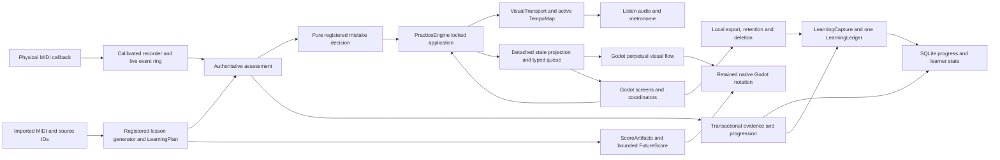

# Piano Teacher architecture

This is a technical contract. The sole active phase plan is [ROADMAP.md](../../ROADMAP.md).

The application is one Godot process with an embedded Python practice engine,
connected through a native in-memory command queue. Source notes,
written notation, teaching policy, playback time and photographed verification
are separate representations. A renderer never determines grading truth, and
reported renderer geometry never counts as independent pixel proof.

## Subsystem map and public boundaries

The following inventory was checked against the source on 2026-11-04. It maps
subsystems, not every implementation helper. Test evidence and remaining
acceptance limits belong to the dated audit in
[verification](../verification/development-audit-2026-11-04.md).

| Subsystem | Owner / principal files | Dependencies and public contract | Invariant |
| --- | --- | --- | --- |
| Process/IPC | `native/src/`, `inprocess.py:EngineCommands`, `godot/inprocess_bus.gd`, `inprocess_request.gd` | One embedded worker; namespaced allowlisted operations and typed success/error replies. | No production listener or separate backend; canceled/obsolete responses cannot invoke callbacks. |
| Application mutations | `server.py:PracticeEngine`, `application/control_dispatch.py`, `application/stage_change.py` | Commands preflight values before stopping a take; existing reentrant lock protects effects. | Rejected stage commands preserve recorder, transport and source; consumers cannot mutate snapshot truth. |
| Source import/library | `music.py:load_midi`, `importing/`, `library.py`, `library_health.py`, `preprocessing_cache.py` | MIDI input, canonical attack IDs, durations, measure grid, hand inference and explicit import warnings. | Internal MusicXML does not become a second product input; immutable source is final performance. |
| Curriculum/selection | `lesson_generators.py`, `adaptive_hybrid_curriculum.py`, `learning.py`, `lesson_stage_semantics.py` | Registry builds complete validated `LessonPlanDefinition`; independent `passage_stages` contributions and `with_feedback`. | Unique stage keys, valid hands, no-op/duplicate exclusion, unchanged final original and content/version-bound progress. |
| Coda/Fukuda | `application/coda_midi_curriculum.py`, `research/coda_*.py`, `fukuda_midi.py`, `fukuda_midi_performance.py`, `fukuda_mistake_store.py` | MIDI-domain transformations, source-local graded feedback; author-differential tooling remains research. | No invented source attacks or unsafe sustain cuts; paper/acoustic parity is not inferred from MIDI contract tests. |
| Input/device lifecycle | `application/midi_connection.py`, `live_input_view.py`, `live_event_ring.py`, `practice.py:Recorder`, `midi_calibration.py` | Callback timestamp before application lock, one saved calibration correction, bounded provisional events and authoritative note capture. | Device loss/reconnect belongs to the engine's session transition; provisional pulses never award mastery. |
| Assessment | `practice.py:evaluate`, `assessment_service.py`, `assessment_clock.py`, `timed_assessment.py`, `application/practice_assessment.py` | Fixed or mapped timing policy uses actual expected seconds and original source IDs; explicit onset/hold tolerances. | Wrong pitch is not double-counted as miss+extra; full takes retain extras; rendering failure cannot discard assessment. |
| Mistake response | `recovery.py`, `application/mistake_responses.py`, `rolling_recovery.py`, `recovery_projection.py` | Immutable explicit evidence → validated decision and source-grid presentation. | Policy owns no clock, persistence or engine; partial retries cannot earn whole-target mastery. |
| Clock/transitions | `visual_transport.py`, `transport_projection.py`, `application/attempt_progression.py`, `practice_transitions.py`, `transport_commands.py`, `score_ack.py` | One monotonic transport and exact active `TempoMap`; authentic meter controls count-in, rest, rewind and handoff deadlines. | Source tempo/Listen/grading share one musical map; the independent presentation world advances without seeks. Score readiness cannot start invisible grading. |
| Evidence/progression | `application/assessment_settlement.py`, `assessment_evidence.py`, `assessment_commit.py`, `learner_progress.py`, `guided_session.py` | Settled `Assessment`, performed BPM, source identity; separate guided acquisition, trouble resolution and full-target application. | Assistance/partial/preview/Perform cannot manufacture mastery; retry BPM is not performed BPM. |
| Learning measurement | `application/learning_capture.py`, `learning_ledger.py`, `practice.py:NoteObservation` | Stable learner/session/attempt/decision IDs, original matching facts, frozen source/rule/map context, explicit terminal and proximal/episode outcomes; existing connection and savepoint. | Identical settlement is a no-op; conflicting payloads fail. Interrupted prefixes never create future misses. Legacy unknowns and pruned coverage remain explicit. |
| Persistence/settings | `progress_repository.py`, `sqlite_transaction.py`, learner/practice stores, `library.py` | SQLite nested savepoints for coordinated evidence+progress; atomic JSON replace and shared settings validators. | Rollback restores plan and pending take; versionless/changed-content progress cannot award current mastery. |
| Score preparation | `application/score_artifacts.py`, `score_preparation.py`, `future_score.py`, `notation/lesson.py`, `notation/model.py`, `notation/assets/` | Frozen `ScoreSelection` keys one semantic/native compilation; bounded worker prepares next two exact stages with three attempts. | Stale source/revision cannot promote; failed fragments never cache successful empty assets; no alternate renderer. |
| Godot score lifecycle | `score_asset_session.gd`, `score_runway.gd`, `practice_score_stage.gd`, `score_step_timeline.gd` | Exact revision readiness, retained next-score acknowledgement and current/future density-aware labels. | Promotion retains the outgoing tail on the forward world axis; idle/paused states admit no new note clips. |
| Painting/layout | `notation/native/view.gd`, `score_layout.gd`, geometry/painter/span components and shared timeline | Authentic glyph/connector assets, one score-wide density and explicit viewport. | Display-only READY framing cannot change grading time; actual first attack can follow rests or belong to another hand. |
| Listen/audio | `application/listen_session.py`, `demo.py`, `sample_piano.py`, `godot/demo_player.gd`, metronome coordinators | Source/revision/token capture, render outside engine lock, typed audio bytes and both score/audio readiness gates. | Same active tempo map; stale render/audio acknowledgement cannot start another stage. |
| Fingering | `fingering/`, `piano-fingering.md`, native fingering components | Offline whole-source prediction, source-keyed corrections and projection; unavailable provider is explicit. | Never changes pitches, source hand, timing, grading or mastery. |
| UI/navigation | `main.gd`, owned screen/session/coordinator/presenter components | Detached snapshots in, explicit value intents out; request owner handles busy/cancel/error state. | Screens do not retain/call private Main; stale commands and old-piece rows cannot navigate current music. |
| Verification/release | `notation/*pixels*`, `scripts/audits/`, native/corpus drivers, build/package scripts | Independent source obligations and real frames; provenance/resource bounds; native binary/manifest/ABI preflight. | Renderer reports are not pixel proof; bounded software checks are not physical acceptance or clean-machine installation. |

### Workflow and time ownership

Import preflights a complete curriculum and saved-stage restoration before
replacing a live session. Source selection creates a versioned stage and frozen
score key; genuine semantic/native preparation must be acknowledged before the
engine begins the count-in. A physical callback timestamps once, applies the
saved correction once, and adds to the current recorder. Fixed/mapped assessment
uses the exact same active source interval and tempo route as Listen.

A callback arriving at a due handoff queues that event with its original arrival
time and correction. The existing worker advances the boundary and drains it;
the hardware callback performs no SQL settlement. `LearningCapture` seals every
exposure before recorder disposal, including partial, guided, preview, Perform
and aborted routes. The ledger replaces the old status-only history writer;
advisory policy history is a bounded read of completed full exposures. Settings
uses typed local export/deletion operations. See the
[measurement contract](../learning-measurement.md) for retention and privacy.

A rolling failure is classified at a source-grid boundary. The registered
policy returns a bounded decision; the engine saves and schedules a rewind/rest
on `VisualTransport`, retaining source identity. Completed full takes become
pending evidence at their **performed** BPM. Later settlement applies evidence,
adaptive generator feedback and progress in one SQLite savepoint. A failed
commit retains the pending assessment for explicit retry; it cannot repeatedly
award progress. Partial clean work returns to full verification.

On eligible mastery, exact prepared+acknowledged next assets promote at the
existing musical deadline. Late preparation receives an empty visual reading
runway; exhausted preparation errors pause scoring without committing
invisible work. No worker response owns progression. Godot maintains a
separate forward-only `ContinuousScoreFlow` for the presentation world:
every frame advances with source tempo even during READY, Pause, Retry and
waiting for future notation. Pre-engraved, source-identity-bound note passes
are admitted and clipped on that one world axis. The engine's authoritative
transport and local tempo map remain the only clocks for MIDI grading,
count-in deadlines, source seeks, Listen and persisted evidence. The frontend
world position never feeds back into musical assessment.

## Backend ownership

`PracticeEngine` is the application transaction boundary. Commands and MIDI
callbacks acquire its existing reentrant lock. Domain objects own curriculum,
teaching targets and recovery decisions. `ProgressRepository` owns the progress
database and durable restoration; `AssessmentService` performs bounded grading
and builds source-bound feedback. `VisualTransport` owns continuous visual time
and preparation scheduling. Pure transport/recovery/navigation projections take
captured facts and return values.

State responses cross an immutable boundary: the engine captures primitive
facts under its lock; frozen `SessionSnapshot` families recursively detach
nested collections; `project_session_state` returns a fresh JSON-shaped payload.
It cannot call the engine, sample clocks, mutate teaching or access a live plan.
The caller retains the established clock sampling order and stateful adapter
operations.

`ScoreArtifacts` receives a frozen `ScoreSelection` and owns selected notation
compilation, semantic projection, canonical Verovio source engraving and
native atlas/fragment preparation. There is no page-PNG renderer or
non-native score mode. It has no engine or plan reference. One compilation
feeds model and native rendering; durable keys bind source/stage/hand.
The engine owns source revisions and acknowledgements, rather than the cache.

`MidiConnection` owns ports, discovery/reconnect deadlines, physical input
activity and hardware-probe diagnostics. The engine supplies an event callback
and owns the musical consequence of losing or selecting a device. A detach /
cancel / close sequence preserves callback and cancellation ordering. Hardware
arrival timestamps are captured before acquiring the application lock.

Source importing, library health and preprocessing depend directly on the
canonical importer. The interactive application exposes only native
notation plus its semantic model. Offline page engraving and verification
utilities remain independent of the active session and are not selectable
presentation backends.

## Composable MIDI curricula

`LessonGenerator` instances own complete curricula; a registry selects the
whole-piece generator, not a conditional branch in `LearningPlan`. The
reusable `compose_lesson_definitions` merges compatible exercise stages
without changing source identities. `AdaptiveComposedLessonGenerator` selects
source-safe passage stages supplied by independent `passage_stages` contributors.
`with_feedback` forwards graded source-ID error families to participants.
The practice engine does not branch on Coda/Fukuda algorithm identifiers,
and an unregistered generator cannot silently select a fallback course.
See [composed MIDI generators](composed-midi-generators.md) for contracts,
course identity, caching, verification and Coda + Fukuda behavior.

## Godot client

Screens own controls, responsive layout and their presentation/editing state.
They receive snapshots and emit intent signals with values. Screens never retain
`main.gd` or call its private methods. Home owns the captured Continue target;
Library owns catalog filtering/debounce and health presentation; Settings owns
tempo drafts, folder selection and the device menu. Stateless `UIFactory`
constructs common controls without an application dependency. Lesson owns its
path, hand/activity choices and captured reset confirmation; its overview session
owns request identity and retry, while the step selector owns numeric selection
intent. The source-measure
picker and performance review are independently usable controls.

Application coordination owns navigation, in-process command results and
resource readiness. Clock interpolation, source revision acknowledgement and continuous
score presentation must retain their established ordering. Remaining application/screen ownership critiques and acceptance gates are
tracked only in [ROADMAP.md](../../ROADMAP.md).

## Native notation

`native/view.gd` is the canvas composition boundary. It validates complete
source engraving, chooses one global density before playback, orchestrates
visible source copies and preparation rests, and publishes actual painted note
positions for UI feedback. It owns whole-frame output and retained preparation
history, rather than caches for every notation feature.

- The shared view/Timeline owns source beat projection and transport snapshots.
- `ScoreLayout` owns the source index, staff geometry, voice/chord offsets,
  rest lanes and vertical fitting caches. Viewport size is an explicit input.
- `InkGeometry` owns authentic texture alpha rows and collision-density evidence.
- `ViewportFit` chooses a score-wide staff gap/density without installing a
  second axis or altering source timing.
- `ConnectorGeometry` owns beam plans, tie endpoints and flag clearances.
- An ephemeral `RenderPass` owns one source copy's visibility/color context and
  painted positions. The view aggregates repeated instances for feedback.
- `SymbolPainter` draws authentic notes, rests, beams, ties, slurs and tuplets.
  `ContextPainter` draws clefs, keys, meters, barlines and preparation measures.
  They borrow source geometry and use an explicit transient canvas. Neither
  retains or calls back into the view.
- `FingeringAnnotations` owns placement, label metadata and editing. Its obstacle
  component owns reservations and sprite-envelope caches. Annotations cannot
  modify canonical source notes, hand assignment, timing or grading.

Changing geometry policy rebinds collaborators and synchronizes viewport size.
Clearing a score rebinds the new shared timeline before clearing owned indexes.
A new score/atlas invalidates only its dependent caches. Pixel corruption
fixtures inject the real geometry or painting policy that owns the behavior;
there are no old view overrides pretending to test moved algorithms.

## Independent verification

Expected symbols come from independently read source XML or a declared MIDI
quantization candidate. Pixel measurement uses retained actual framebuffers and
external Verovio/font references. Unsupported, ambiguous and missing evidence
stay in coverage denominators.

`pixel_ink`, `pixel_context`, `pixel_motion`, `head_registration` and
`captured_frames` are lower-level evidence owners. Feature status/source facts
and glyph evidence have single owners; stems, detached adornments, structure
and ledgers have separate proof families. `feature_pixels` coordinates source
requirements and physical-ink claims per call. The separate visual ledger owns
independent source obligations, occurrence binding and construct-specific
acceptance. Its policies import neither detectors nor image libraries, so a
producer's aggregate success flag cannot authorize an original obligation. Detectors do not call back into
coordinators, import the application or borrow native layout. Bounded image/font
caches retain the existing budgets. Generic SVG structure and isolation live in
`source_svg`, below both asset generation and independent reference readers;
it has no renderer, image-classifier or application dependency. Moving a proof preserves thresholds and
serialized reports; positive fixtures and deliberately corrupted controls
exercise the same acceptance rules.

## Audit execution

Capture, proof and orchestration have distinct lifetimes. `capture_store` owns
provenance and atomic publication/recovery; `capture_runner` owns Godot capture.
`StageRecorder` owns a case checkpoint, passed explicitly to execution.
`worker_protocol` serializes case execution/results; `worker_ownership` validates
process identity and session ownership; `job_executor` bounds resources, queues,
deadlines, recycling and cancellation. No process-global current-case variable
routes checkpoint updates. Source and dependency identities cover the extracted
modules, so changed code cannot silently reuse an old verdict. Successful
captures remain independently reusable when only proof code changes.

## Validation policy

`scripts/ci-smoke.sh` is the bounded automatic architecture/parse gate. The
explicit `scripts/verify-notation.sh --ci` runs broader real-frame, corruption,
progression and interruption regressions. The full 24-shard audit is a separate
operation; a refactor's green smoke gate does not certify the entire corpus.
The parse gate checks emitted diagnostics as well as Godot's exit code, with a
25-second bound; an emitted parse error cannot pass by exiting zero. Dated architecture inventories and superseded refactor plans are preserved
under `docs/archive/development/`; they are not active plans.
