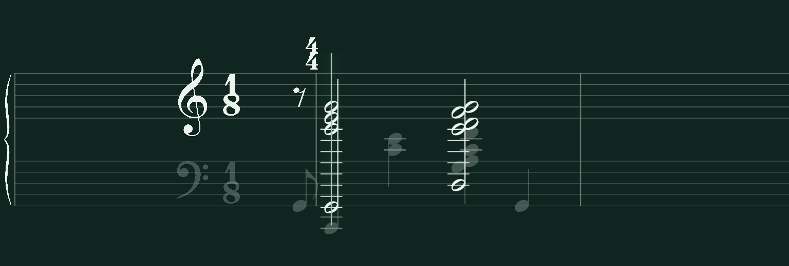
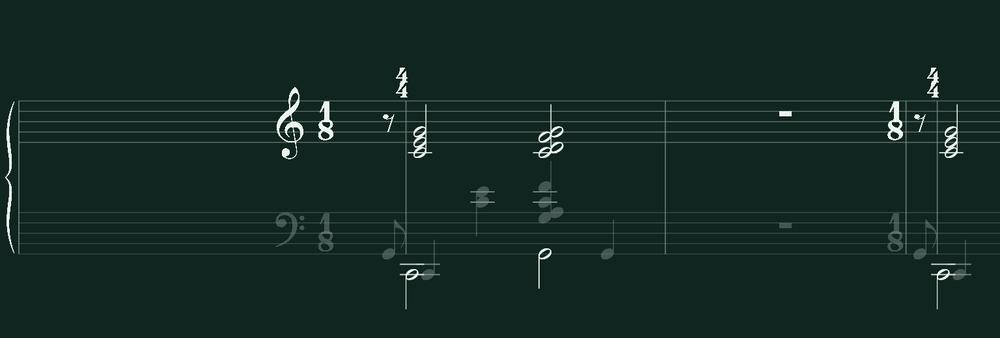
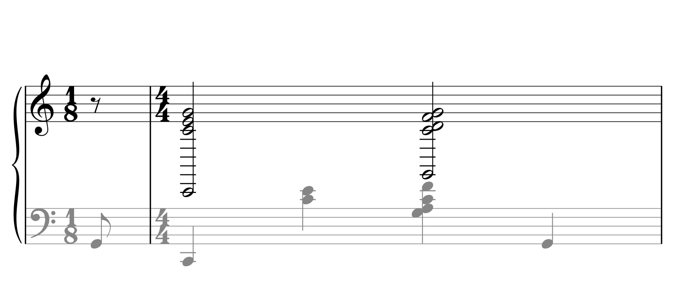
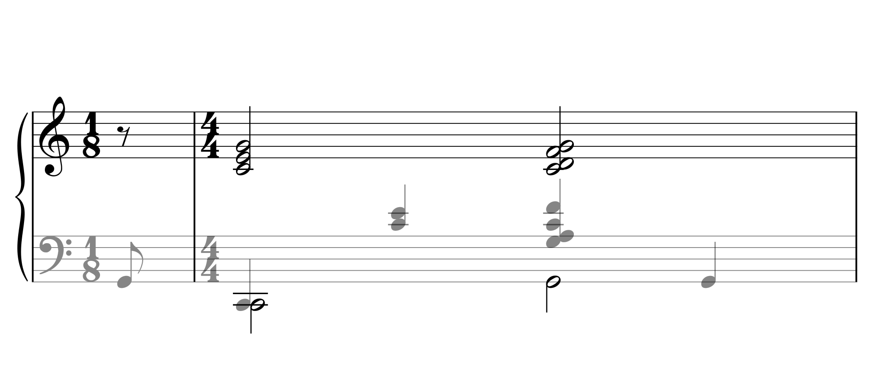

# Peace Piece: registers and preparation

The supplied screenshots show two independent defects. The retained before
capture and MusicXML below were recorded before changing either algorithm.
The after images use the actual Godot compositor and unchanged source MIDI.

| Before | After |
| --- | --- |
|  |  |
|  |  |

## Exact source and chord diagnosis

The MIDI uses 480 ticks per quarter beat. These are the complete opening attack
groups, before lesson simplification. Track/channel are zero-based; hand and
source voice are the original importer assignments.

| Onset tick / beat | Release tick | MIDI pitches | Hand; track; channel; source voice | Source event ordinals |
| --- | --- | --- | --- | --- |
| 0 / 0 | 227 | 43 | left; 1; 0; `midi-t1-c0` | `midi-t1-e3` |
| 240 / .5 | 695 | 36 | left; 1; 0; `midi-t1-c0` | `midi-t1-e6` |
| 240 / .5 | 1200 | 36, 60, 64, 67 | right; 0; 1; `midi-t0-c1` | `midi-t0-e29`–`e32` |
| 720 / 1.5 | 1175 | 60, 64 | left; 1; 0; `midi-t1-c0` | `midi-t1-e8`, `e9` |
| 1200 / 2.5 | 1655 | 55, 57, 60, 65 | left; 1; 0; `midi-t1-c0` | `midi-t1-e12`–`e15` |
| 1200 / 2.5 | 2160 | 43, 60, 62, 65, 67 | right; 0; 1; `midi-t0-c1` | `midi-t0-e37`–`e41` |
| 1680 / 3.5 | 2135 | 43 | left; 1; 0; `midi-t1-c0` | `midi-t1-e20` |

`before-source.musicxml` encoded each simultaneous right-hand group as a
single treble chord. Full Verovio reproduced its huge common stem. The native
chord fragment contained four heads and one stem, with **no ledger paths**;
the native compositor correctly added the many ledgers that treble C2 required.
Thus the source-to-staff grouping was already wrong before native composition.

MIDI hand assignment now remains performance ownership, separately from the
staff chosen for notation. A conservative clef-relative register policy puts
an isolated, remote register cluster on the other existing piano staff in an
independent notation voice. The opening RH C2/G2 therefore use the bass staff.
The nearby RH chord stays in treble. Resident LH voices remain separate,
including the simultaneous RH half/LH quarter C2 unison.

The generator preserves all original notes, IDs, velocities, onsets, releases,
tracks, channels, source voices and hands. All **18 source records** in the
before fixture exactly equal `after-source-model.json`'s source records. Only
the engraved staff/notation voice differs. Source-bound coloring, feedback,
ties and fingering edits continue to use the original performing hand.
Shared ledger paths in the reference remain bright whenever an active hand
requires them. Authored MusicXML and explicit source clef changes retain their
written staff choices.

Complete authentic ink also fits the native viewport: uniform staff spacing
accounts for full stem/beam extents and simultaneous upper/lower ink, avoiding
clipped low down-stems or an interstaff collision in compact views. Stems are
never shortened or clipped to conceal the original defect.

The existing engraving cache key advances from v2 to v3. A regression seeds
the actual legacy wide-chord engraving, proves that it is replaced, and proves
that a second engine reuses the corrected cache without rendering. Source
imports, generic atlases, fingering plans and corrections retain their caches.

## Preparation and playback

The canonical source meters are `1/8` at beat 0 and `4/4` at beat .5. Its first
boundaries remain `0, .5, 4.5, 8.5, 12.5`. The previous repetition descriptor
used the literal opening 1/8 as its preparatory meter: only .5 quarter beats.

The existing bounded pickup policy now selects the immediately adjacent 4/4
measure for this rest. The first lesson lasts 4.5 source beats, followed by a
four-beat rest from 4.5 to 8.5. The next source pickup starts at 8.5; the next
C2 attack is at 9.0. At 40 BPM the rest is exactly six seconds. Retry/recovery
uses the same descriptor and duration. A genuine 1/8 passage without the
adjacent normal-meter transition retains its own meter.

Both staves display an authentic full-measure rest between the same barlines.
The native context restores the real 1/8 at the next source opening and the
real 4/4 change half a beat later. Returning signatures clear the closing
barline using their actual glyph width, including JSON numeric values.
The initial Play count-in retains its existing short-duration cap; it is a
separate UI count-in, not this engraved repetition/Retry rest.

## Evidence and verification

- `reported-right-outline.png`: supplied screenshot, lesson step 2.
- `before-*` / `after-native.png`: the same 18-note source passage with only
  right-hand ink selected; the original resident left-hand notes remain.
- `after-native-both-c2.png`, `after-native-both-g2.png`: both original hands.
- `after-native-full-rest.png`: independent framebuffer rest proof.
- `after-app-right-outline.png`, `after-app-both-hands.png`,
  `after-app-full-rest.png`: full app screenshots captured through the Godot
  MCP; runtime reported `native_ready=true` and no practice contract error.
- `live-rest-state.json`: the actual backend paused inside `preview_gap` at
  40 BPM, revision 3, four-beat gap, without an extra count-in.
- `diagnosis.json`: retained source facts and original fragment inventory.
- `after-source.musicxml`, `after-source-model.json`, `after-verovio.svg`:
  source-bound notation and full reference.

Focused framebuffer coverage uses real lesson steps 2, 3, 7, 9 and 10, with
whole-source production fingering. Pixel geometry comes from detected PNG
staff rails and independent Verovio font/reference ink, not renderer geometry.
The negative controls remove a half head, truncate a stem, add a spanning
stem or ledger ladder, shorten/lengthen a visible rest and shift the next
attack. Authentic stem lengths, notehead-family discrimination, .80 glyph
matching, and scrolling tolerances remain enforced. Timing coverage includes
30/40/56/120 BPM, both hands, exact deadlines, pause/resume, grading and Retry.
Ordinary/shared chords, overlapping voices, ties, beams and tuplets remain in
the fast regression gate. No full corpus audit is run for this change.

Final `--ci` result: **559 passed, 6 skipped in 284.59 seconds**, followed by
a successful Godot main-script parse check (overall exit 0). This run captured
fresh framebuffers. `fast-ci.log` and `verification.json` record the result.
The focused cache/backend run passed 35 tests. The historical repeat-dot
negative fixture now aims at the actual dot lane at the fitted staff size;
the unchanged oracle rejects 39 dot-clearance intersections under the old
reservation algorithm, with zero main-stroke intersections. Its focused
module passed 8 tests with 4 conditional skips.

The import warnings about 33 unmatched note-offs and a later implausible 131/4
meter are existing source repairs and remain explicit; they are unrelated to
the opening staff and preparatory-meter defects. The register inference is
deliberately conservative, rather than a general score-reengraving policy.

Recommended bounded local verification:

```sh
./scripts/verify-notation.sh --ci
```
