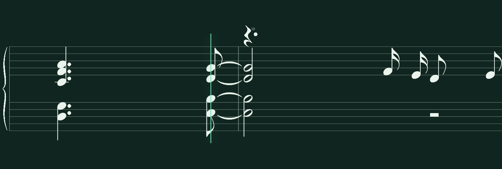
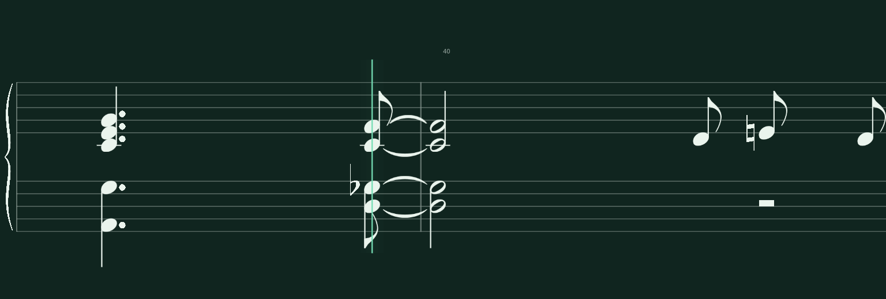

# Native notation audit progress — 26 October 2026

This round starts at `c69da06`. Historical failures are leads for diagnosis,
not current library results. No complete corpus audit was run.

## Historical baseline and provenance

The later shard-0 checkpoint contains **632 cases**, including **630 completed
comparisons: 332 passed and 298 failed**. Its 301 summary error entries also
include two capture errors and one run-wide code/input-change error. The older
interruption archive's 361 entries belong to a different execution.

The retained evidence is intact: 29,710 screenshot hashes and 2,528 result
witnesses match. However **0/632 root captures are directly reusable as current
results**: their fixtures/manifests lack today's explicit annotation-free
canonical capture configuration and their renderer/protocol digests differ.
Six of seven representative source XML regenerations match byte-for-byte;
Peace Piece's notation changed. Source equality alone cannot authorize old
renderer output. All old captures, successful results and both ZIPs remain.

| Historical underlying observation | Cases | Symbol mismatch entries |
| --- | ---: | ---: |
| Tie attachment/ownership | 21 | 124 |
| Ledger presence/position | 28 | 75 |
| Rest corridor/clearance | 10 | 14 |

These entries can repeat a pair's failure on its individual notes; they are
not counts of distinct rendering bugs. Likewise the 136 cases with incomplete
source tracking propagate into rhythm, flag-absence and boundary outcomes.
The report's "articulation" family actually refers to ambiguous accidentals.
The retained fixtures contain no fingering assignments or authored fingerings.

The compact [machine baseline](evidence/native-audit-2026-10-26/historical-baseline.json)
records the inventory, hashes, archive provenance and classification caveats.
The full local per-case index is retained at
`/tmp/notation-audit-baseline-2026-10-26.json`.

The final preservation check found the root ZIP had been regenerated as an
aggregate of existing reports. That replacement was saved separately. The
original shard-0 archive was reconstructed from untouched members and its
generated-entry timestamps, then restored **byte-for-byte**, matching its
original SHA256 `d3e1246265dd977f40289b42b2b71bce5fd4bdd0a4601c69bcae3da8e9696924`.
The interruption ZIP is unchanged. No case/capture data was discarded; see
[the preservation record](evidence/native-audit-2026-10-26/diagnostic-archive-preservation.json).

## Current classification and reproduction

| Category | Established evidence |
| --- | --- |
| Native rendering | Fresh Autumn Leaves 37–40 reproduced two ties intersecting the starting eighth-note flag. The corrected output proves all eight ties at both tested viewport sizes. |
| Source parsing/generation | No new defect established in this passage. Generated XML is byte-identical to its retained counterpart, and the original source IDs/pitches/clocks bind. |
| Verovio/source matching | The selected ties have identifiable source endpoints and complete original references. Historical ambiguous-group messages are not evidence of an incorrect current native symbol. |
| Independent pixel verification | Corrected an inadmissible tie candidate-span shortcut and transparent head padding in ledger measurements. Final contour, attachment, ownership and numerical thresholds remain unchanged; the original flag collisions still fail. |
| Insufficient evidence | Noncanonical, superseded or missing retained captures cannot prove current output; ambiguous/occluded contours remain blocking rather than silently passing. |

The exact fresh failing pairs are:

| Piece/case | Source | Printed endpoints | Source clocks | Pitch |
| --- | --- | --- | --- | --- |
| Bill Evans / Autumn Leaves, 37–40, both hands | `midi-t0-e360` | `pt5493b2bbe792941e6a48290d0b403145s0` → `s1` | 3.6 → 4.0 | G4 / 67 |
| Same passage | `midi-t0-e389` | `pt47d099f4d86542ab6538e88326caf578s0` → `s1` | 11.6 → 12.0 | F4 / 65 |

Each attack is an eighth-note quintuplet fragment continuing as a half note
across the barline, in an actual two-note chord. The independent verifier
registers both endpoint head contours, measures the image translation and
finds the upper curve joined to the first note's flag. This is not an absent
tie inferred from an audit string. The actual generic half/half tie contour
has head-edge margins that do not account for a flag on the connector side.
Full Verovio supplies the appropriate flag clearance when engraving that
context; a local controlled engraving reproduced that difference.

Fresh before evidence, source XML, full reference SVG/PNG and producer manifest
are under [the evidence directory](evidence/native-audit-2026-10-26/).

| Before | After |
| --- | --- |
|  |  |
|  |  |

[Compact F4 framebuffer](evidence/native-audit-2026-10-26/after-autumn-compact/native-11.60.png)
and [full original reference](evidence/native-audit-2026-10-26/autumn-reference.svg).

## Correction and verification record

The focused real-passage regression first failed as expected: six of eight
pairs verified and the two flagged chord ties did not. The existing tie atlas
now contains its two original half-note contours plus ten authentic flagged
start/end contexts, covering eighth through 128th notes. Source head-family
centres and widths preserve actual engraved edge clearances. Chord members
inherit their leader's flag/stem context; beamed notes do not invent a flag.
Explicit source placement remains authoritative. Atlas cache version 2 and
warm-cache reuse are tested. Painting and fingering reservations use the same
destination rectangle, so the corrected ink cannot escape annotation bounds.

The new authentic flagged contour also exposed a verifier shortcut: it rejected
curves shorter than centre separation minus two staff spaces before inspecting
their endpoints. That excludes valid flag-aware margins and wide whole heads.
For **ties only**, the preliminary bound now follows mathematically from the
existing head-rectangle distance limit: `right.left - left.right - 2*.9*gap`.
Every candidate must still meet the unchanged `.9` endpoint-distance,
curvature, thickness, placement, connectivity and exclusive ownership checks.
Slur pruning is unchanged. An existing actual whole-note attachment regression
was strengthened to require complete independent proof and observed RED first.
The original obstructed Autumn images still yield exactly two mismatches.

All **34 source-note records and 48 notation events** in the selected Autumn
passage are identical before/after. The real MIDI release duration remains
`1093/480` beats for both affected attacks; the pre-existing written duration
quantization is unchanged. Pixel comparison of the four standard-size frames
confirms every registered endpoint head is identical and every changed pixel
lies inside the two independently located tie corridors. Other source ink is
pixel-identical outside those corridors.

### Ledger measurement: Liszt, measure 78, LH original

Current canonical capture `learn-0077-left-original` reproduced a false missing
ledger on E-flat2 / MIDI 39, source `midi-t1-e1565`, notation
`pt089fba1ff62917b7c12fba5f961e0869s0`, F clef line 4, source step -2.
At `native-0.30000.png`, the pale ledger occupies `[595,637)` on row 424.
The padded registration box `[597,635)` suggested two-pixel wings, while the
registered external font's actual visible head `[598,634)` leaves three pixels
on each side. The unchanged `.12`-space requirement rounds up to three pixels.

The ledger path now measures the independently registered reference outline's
visible alpha extent and retains the original `registration_bbox` in evidence.
It never takes a head edge from the observed head/ledger/stem union. Source
pitch, actual display clef, contour registration, playhead exclusion, continuous
wing requirement, thickness and vertical tolerances remain enforced.

The immutable producer images first gave ledger **1/2 → 2/2** under this
verifier-only correction. After all renderer changes stabilized, one fresh
bounded capture reconfirmed **2/2**, identical source XML and **45/45 native PNG
hashes unchanged**. All 51 full-producer screenshot hashes match its fresh
manifest. The evidence directory retains a clearly labeled four-frame ledger
excerpt plus the full producer manifest/verification summary.

### Validation

- Final affected suites: **199 passed in 65.69 s**.
- Final expanded fast CI: **658 passed, 6 skipped in 348.86 s**, followed by
  successful Godot main-script parsing; overall exit 0.
- Actual Autumn captures at **1536×520 and 1216×455** each prove all eight ties.
  Sixteen real-curve corruptions erase, detach, straighten or break the two
  repaired pairs; the original obstructed output remains a mismatch control.
- All 12 atlas entries, warm cache, ordinary contour identity, both flagged
  endpoint directions, chord leaders, beams, explicit placement and actual
  fingering clearance have positive/negative controls.
- Six new Liszt whole-head ledger corruptions remove ink, shorten either wing,
  detach a wing, move its Y or break its continuity. Each remains a mismatch,
  including a short two-pixel wing. Unreadable native atlas/geometry reports
  cannot affect the positive proof.
- Existing Peace Piece register/hand separation, fingering inference and
  corrections, grading, chord/unison/beam/tuplet behavior, annotation-free
  canonical capture, repetition, preparation and pause/Retry tests remain in
  the successful fast gate. Godot MCP project inspection also succeeded.

Independent review found no Critical or Important issues. The scopes above
overlap; their test counts must not be added. See the retained logs, source
contracts, pixel-preservation proof and before/after observations under
`docs/evidence/native-audit-2026-10-26/`.

## Remaining priorities

1. Other retained ties and ledger reports still need current per-case proof.
   This round proves the selected root causes, not every historical observation.
2. Liszt 78's **whole case still fails**: its continuation augmentation dot is
   ambiguous because it connects to neighboring ink; both meter recognitions
   remain unverified, opening key recognition unsupported, whole-note rhythm
   unsupported and continuation rhythm unverified. These outcomes retain their
   distinct meanings and are not classified as new rendering defects.
3. Real rest-shape/corridor failures remain to be independently reproduced;
   the selected Autumn capture's high-rest editorial diagnostic alone does
   not establish a current rendering defect.
4. Dense/overlapping head registration, source-clock ownership and resulting
   boundary/rhythm failures still require separate evidence; failed absence
   tests dependent on unbound heads do not establish a missing flag.
5. Accidentals touching other ink, unusual tuplets and insufficiently visible
   rests remain explicit limitations. No library-wide improvement count is
   inferred from this round's representative fixes.

## Next bounded run

The verifier is ready for another bounded source/shard run with the existing
two-worker resource controls, provenance checks, checkpoints and resume policy.
Planning only confirms the command below selects **nine Autumn Leaves cases**
(four original windows and five curriculum stages), including measures 37–40.
It has **not** been executed as part of this round. A 120-second case deadline
bounds this next diagnostic run; failures remain explicit. The new output
directory preserves the historical shard and its successful captures.

```sh
rtk proxy env LIBGL_ALWAYS_SOFTWARE=1 OPENBLAS_NUM_THREADS=1 xvfb-run -a \
  .venv/bin/python scripts/check_native_verovio_overlay.py \
  --only Autunm_Leaves --shard-count 24 --shard-index 0 --workers 2 \
  --case-timeout 120 --resume --out notation-check-results/autumn-bounded-2026-10-26
```
