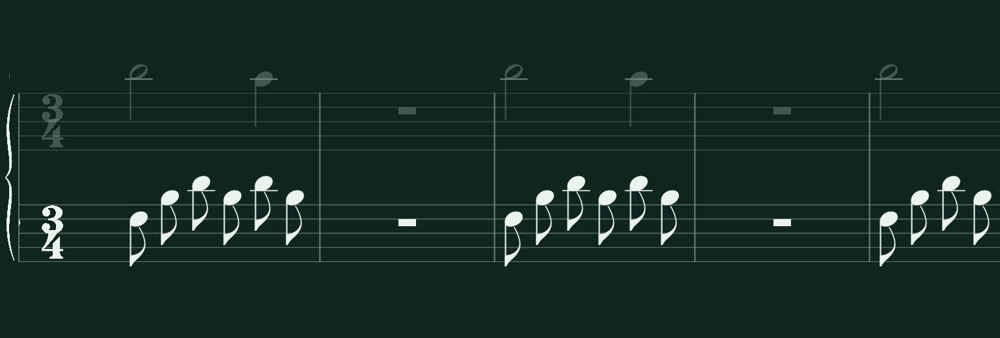
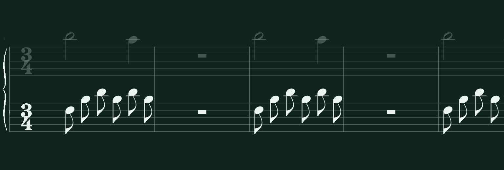
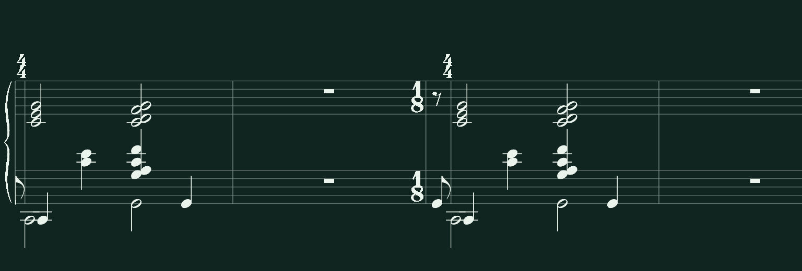

# Invariant measure widths and score velocity

The native renderer now uses one boundary projection for source measures,
terminal boundaries and preparation measures. Every principal boundary is
`screen_x(beat) - 1.35 * staff_gap`; the constant engraving clearance cancels
when measuring the distance between two boundaries. Notes retain their
original beat positions. Preparation, populated, simplified and rest-only
measures therefore use the same pixels per quarter beat.

The defect was an asymmetric clearance, not an accelerating musical clock.
Previously, internal source boundaries and the right preparation boundary
used a 1.35 staff-space lead, while source terminals and left preparation
boundaries used 0.45. Preparation lost 0.9 staff spaces and the preceding
source measure gained that width. The error changed with glyph size, even
though all objects still moved at the same camera speed.

Earlier movement tests correctly detected uniform translation, which can
coexist with incorrect measure widths. The preparation-boundary helper
required both rules and `left < right`, explicitly allowing their separation
to differ from the semantic duration. It now independently requires
`duration * 96` within 1.5 actual pixels. Its MusicXML meter inference also
recognizes the adjacent Peace Piece pickup-to-4/4 change; the source pickup
remains half a beat while preparation occupies four beats.

`BarlineLayout.project()` is shared by source and preparation painting.
Meter/context glyphs use the actual stroke/dot clearance and move when
necessary, without moving musical boundaries. Existing junction ownership
continues to produce one boundary. `view_base.gd` rejects density changes
after an attempt/preparation starts, including pause and between repeats;
loading a new score or clearing it permits a new density. Tempo changes do
not reload engraving. The Python practice descriptor now rejects gaps,
overlaps, nonpositive/nonfinite spans and inconsistent source totals.
Backend speed metadata now reports the derivative of the existing position
function during ordinary playback and zero during pause. Source timing,
MIDI pitches/releases, hand ownership and grading formulas were not changed.

The following measurements come from unmodified 1536×520 native PNGs at
96 pixels per quarter beat. Before images are retained successful captures,
not reconstructed failures. Current captures reuse their source fixtures.

| Capture and measure | Beats | Expected px | Before px | After px |
|---|---:|---:|---:|---:|
| Ala, source terminal | 3 | 288 | 307.5 | 288 |
| Ala, preparation | 3 | 288 | 268.5 | 288 |
| Source-rest fixture, source terminal | 4 | 384 | 403.5 | 384 |
| Source-rest fixture, preparation | 4 | 384 | 364.5 | 384 |
| Peace Piece, source 4/4 | 4 | 384 | 398.5 | 384 |
| Peace Piece, preparation | 4 | 384 | 369.5 | 384 |
| Peace Piece, genuine pickup | 0.5 | 48 | 48 | 48 |

Ala before:

Ala after:

Peace Piece before:

Peace Piece after:

The evidence directory also contains [source-rest before](measure-invariants/source-rests-before-rest.png),
[source-rest after](measure-invariants/source-rests-after-rest.png), an
[uncropped production-app frame](measure-invariants/source-rests-app-after.png),
the corresponding MusicXML sources, and a
[SHA-256 screenshot manifest](measure-invariants/screenshot-manifest.json).
Images were copied byte for byte, without resampling or stitching.

The permanent `measure_pixels.py` verifier independently detects both sets
of five staff rails and full-grand-staff barline strokes from PNG contrast.
Principal rules of explicit double/heavy boundaries are distinguished from
extra boundaries. Missing, moved, wrong-style and duplicate strokes fail.
A left-clipped double boundary must still have its visible principal rule;
positive and deliberately missing-principal controls cover that edge case.
Expected musical beats come from independently parsed MusicXML/public
transport inputs, never native renderer geometry.

One shared clearance is calibrated from the whole first frame per viewport
and frozen across later frames and tempos. Recalibrating after each frame,
gap or repeat is forbidden: it could conceal a camera jump. The positional
and width tolerance is always 1.5 physical pixels. No contrast, coverage,
notehead recognition or other existing acceptance threshold was loosened.

The application matrix renders 900 native frames and their full-app frames:
Ala bars 29–32, Peace's pickup and 4/4 source, a real simplified Peace lesson
with omitted source IDs, a source full-measure rest, and a mixed-meter
fixture. It covers genuine 3/4, adjacent dense/sparse measures, preparation,
ordinary terminal boundaries, repetitions and exact pause/resume. Each
viewport loads its model once across 40, 80 and 120 BPM. The largest measured
boundary-position error in this matrix was 0.468 px.

| Requested viewport | Physical native ROI | Public DPI scale | Physical px/beat | Four-beat width |
|---|---|---:|---:|---:|
| 800×600 | 770×287 | 1 | 96 | 384 px |
| 1220×780 | 1156×459 | 1 | 96 | 384 px |
| 1600×1000 | 1520×599 | 1.25 | 120 | 480 px |

DPI scaling changes the physical public density and fixed system gutter,
not the tolerance. Staff spacing is measured from the image. The fixed
native-view crop locates the canvas only; it does not supply any musical
geometry to the oracle.

These are actual principal-stroke displacements in the source-rest fixture
at 1220×780. Multiple independently detected rules agree in each row.
Positive displacement means the score moves left. The interval spans from
the last photographed populated/rest frame to the first frame of the next
window, retaining the same boundary IDs and calibration.

| BPM | Transition | Seconds | Expected px | Observed px | Observed px/s |
|---:|---|---:|---:|---:|---:|
| 40 | populated → preparation entry | 5.4375 | 348 | 348 | 64 |
| 40 | preparation → repeat | 2.625 | 168 | 168 | 64 |
| 80 | populated → preparation entry | 2.71825 | 347.936 | 347.5 | 127.840 |
| 80 | preparation → repeat | 1.312 | 167.936 | 167.5 | 127.668 |
| 120 | populated → preparation entry | 1.8125 | 348 | 348 | 192 |
| 120 | preparation → repeat | 0.875 | 168 | 168 | 192 |

Successive short frames are checked as well. At 40/80/120 BPM their elapsed
times are approximately 0.1875/0.09375/0.0625 seconds for one eighth of a
quarter beat. Raster centroids can alternate between 11.5 and 12.5 px around
the nominal 12 px displacement; exact sampled milliseconds determine each
expectation. This quantization is why a short-frame velocity estimate is
less precise than its absolute displacement. Both short and longer
transitions retain the same 1.5 px bound. The compact viewport skips only
long transitions that cannot retain two common barlines; its successive
short-frame comparisons remain mandatory.

Backend-derived original-MIDI fixtures add preview, clean automatic repeat,
failed take, local recovery and manual retry at initial 40/80/120 BPM (60
checks over 15 captures). They verify source ID/onset/duration/pitch/hand
identity, frozen pause/resume, preparation widths and forward/backward
motion. At initial 80 BPM, a failed take adapts to 72 BPM: preparation/replay
move 12 px per 0.1041667 s (115.2 px/s); the separate recovery samples move
−145 px each against an expected −144.96 px. A clean take adapts from 80 to
90 BPM and moves 12 px per 0.0833333 s (144 px/s), without re-engraving or
changing source coordinates. Recovery speed is deliberately independent of
forward BPM; its signed derivative is checked against backend samples.

All seven controls change actual test-only GDScript rendering/projection;
none edits the PNGs, source model, source notes or BPM. Each keeps an
independently matched source notehead and rejects the corrupted output
using the correct reference's frozen calibration.
The entire uncorrupted control sequence must pass that same verifier,
including terminal frames with looping explicitly disabled. This prevents
an incorrect expectation of future repeats from falsely rejecting a control.

| Deliberate renderer mutation | Result |
|---|---|
| Four-beat preparation compressed to half width | Rejected |
| One preparation boundary moved 8 px | Rejected |
| Extra boundary inserted 8 px beside the original | Rejected |
| Preparation alone uses half the density | Rejected |
| Camera speed changes halfway through the pass | Rejected |
| Preparation translated 0.25 beat with source notes intact | Rejected |
| Camera jumps 0.25 beat at repetition | Rejected |

Exact boundary centers, observed width ranges for all 45 viewport/BPM/case
combinations, successive/long displacement samples, 15 backend flows and
corruption error examples are in [measurements.json](measure-invariants/measurements.json).

Validation before the final fast gate: the stronger old boundary check
failed on five retained captures before the fix; the density-lock test
failed in four assertions before the guard. Both then passed. Focused
model/transport/framebuffer checks passed (225 tests), followed by the
final oracle/app/corruption checks (61 tests), including the missing visible
principal regression. A further whole-sequence positive control first
reproduced an incorrect terminal-frame repeat inventory, then passed along
with all seven real renderer mutations (8 tests). Backend/MIDI frame tests passed (60 tests). Godot MCP
validated `res://notation/native/view.gd` with no diagnostics.

The final fresh `./scripts/verify-notation.sh --ci` gate passed: **849 passed,
6 existing fixture-conditional skips, 477.77 seconds**, followed by successful
headless Godot validation of `main.gd` (exit 0). The six skips are four
inapplicable fingering-negative combinations and two recovery-context
combinations; their corresponding positive cases still run. The first gate
also passed before the additional whole-sequence positive control was added.
The [captured final CI log](measure-invariants/fast-ci.log) records the result.
Independent review approved the implementation and both verifier corrections.

The new width oracle proves solid full-grand-staff rules only; unsupported
partial, dashed, dotted or absent styles fail closed rather than borrowing
assumed geometry. Repeat dots themselves are not width anchors. Existing
connector, glyph, note identity, meter/clef, grading, register, fingering and
manual-override tests remain separate protections. Captures use controlled
production transport snapshots and real rendering; they do not measure
hardware audio latency, compositor frame pacing or every corpus measure.
The exhaustive 24-shard audit was deliberately not run. Existing audit
captures and the historical preservation archives remain intact.

Run the focused local gate with `rtk proxy ./scripts/verify-notation.sh --ci`.
It includes the new invariant regressions and stops before the corpus audit.
