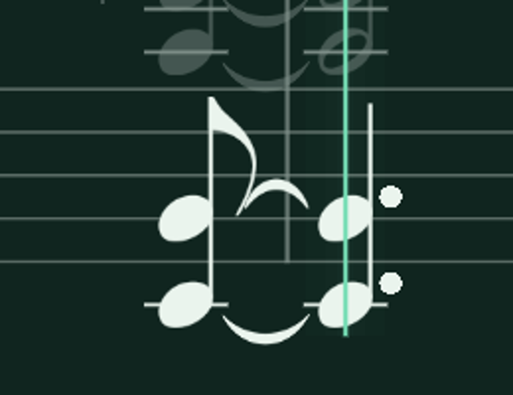
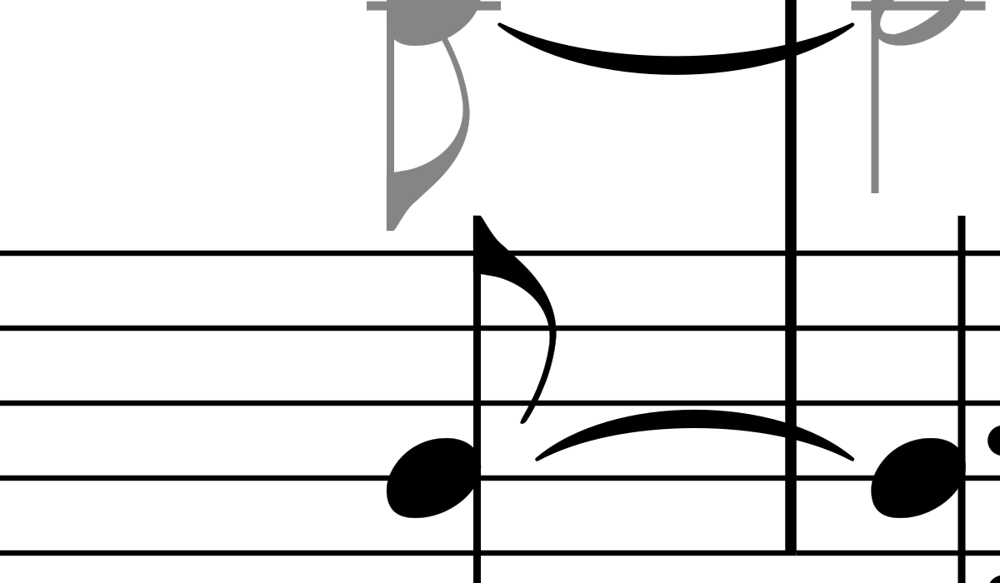
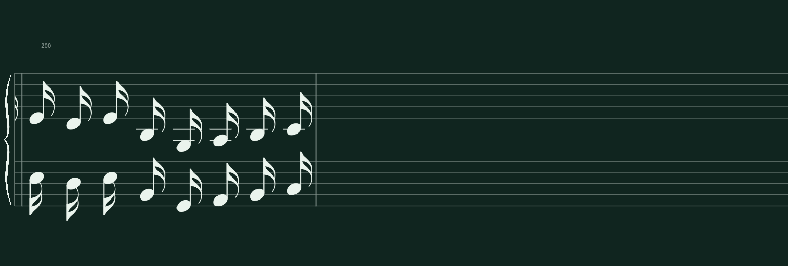

# Interrupted overnight notation audit: findings and bounded recovery

Investigated October 27–28, 2026. The audit ran October 26–27. No complete audit was rerun. Existing audit outputs remain immutable; fresh diagnostic captures and capped profiles were written under `/tmp`. The initial investigation/fixes were retained in `6301fab` while main advanced to `6e56142`; this continuation preserves those intervening application refactors.

## What actually ran

All locally available shard directories, summaries, case receipts, stages and checkpoints were inventoried. Only shards **0–7** exist. The diagnostic ZIP contains shard 7, whose summary is byte-identical to its local counterpart. It does not contain the earlier shards.

| Shard | Expected cases | Completed cases | Passed | Failed receipts | Still pending | End state |
|---|---:|---:|---:|---:|---:|---|
| 0 | 632 | 632 | 310 | 322 | 0 | Natural end, failures |
| 1 | 635 | 634 | 310 | 325 | 1 | Worker timeout |
| 2 | 607 | 607 | 275 | 332 | 0 | Natural end, failures |
| 3 | 587 | 586 | 295 | 292 | 1 | Natural end, one rejected render |
| 4 | 623 | 471 | 228 | 244 | 152 | Worker timeout |
| 5 | 604 | 604 | 295 | 309 | 0 | Natural end, failures |
| 6 | 569 | 62 | 22 | 42 | 507 | Worker timeout, one rejected render |
| 7 | 602 | 8 | 2 | 6 | 594 | Handled signal interruption |

Across these eight shard denominators: **4,859 expected, 3,604 completed, 1,737 passed, 1,867 completed failures, three timeouts and two render errors**. There are 3,609 outcome receipts and 1,872 failed receipts. Shard 7 adds one batch signal message, producing 1,873 summary failure strings; that message is not another failed case. Pending = expected minus completed (1,255); this includes errored/timed-out/in-flight work and must not be described as entirely unattempted. Shards 8–23 have no results, and source/measure coverage is distinct from case completion. Only 0, 2 and 5 completed every case; 3 reached its end with one rejected case.

The run began at **2026-10-26 21:30:59 UTC**. Final termination was recorded at **2026-10-27 08:45:21.968 UTC** as `signal interruption`. Both SIGINT and SIGTERM use that handler: the saved evidence does **not** identify the signal or sender. Kernel and system journal searches over the audit interval found no relevant OOM kill, segfault or crash evidence. The boot ID was unchanged during the audit. Therefore an OOM kill is **not established**.

The receipts record **two workers**, a **600s worker deadline** and **3,072 MiB resource limit**, not seven parallel workers. Maximum recorded worker RSS was 713,544 KiB (about 697 MiB). This run provides no evidence that seven Godot workers exhausted memory.

Worker deadlines occurred in `unexpected-symbols` for:

- Shard 1: `42-xml_long_multipage/perform-0024-both-original`.
- Shard 4: `09-Merry-Go-Round-of-Life/perform-0158-both-original`.
- Shard 6: `12-Peace_Piece_-_Bill_Evans_(Piano_Solo)/original-0061-0064-left`.

The two renderer errors are Peace Piece `original-0049-0052-left` (shard 3) and `original-0049-0052-both` (shard 6). Both rejected missing required Verovio tuplet artwork, rather than crashing. The authentic group is `pt500a7ec7e70ef20510ff0884d3d50f6bs0|pt46cb6918639b16b306bb100f4a212b9as0|pt122455ceb8297d2b3a4eeb4cfdbd593bs0`.

## Recurring failures and their interpretation

The first reported failure categories include 429 measure obligations unverified, 312 source-clock tracking failures, 216 flag-absence obligations unverified, 144 ambiguous accidental identities, 105 native head/staff checks, 83 unverified flags, 83 ambiguous dots, 54 ledger mismatches, 52 unsupported keys, 46 rest-rhythm checks, 44 meters, 43 unverified ties, 36 unexpected glyph cases and 33 tie mismatches. These are first-failure counts, not a count of independent engraving defects or all 42,007 receipt error messages.

A missing photographic witness, ambiguous source/voice binding, cropped/occluded symbol and actual wrong ink are different outcomes. Unknowns remain unknown. Rechecking three retained structure cases after fixing motion registration left their verified/unverified counts unchanged: this fix does **not** resolve all 429 measure failures. The retained Hanon boundary investigation separately established genuine flag/barline overlap. The Ala ledger/dot complaint and same-clock incoming accidental/header contact remain unresolved.

## Confirmed corrections

1. **Chord flag/tie collision:** the real Bill Evans B-flat2 MIDI attack is track 1 event 57, pitch 46, tick 22848 / beat 47.6, released at event 59 / tick 23756 / beat 49.4916667. Its written continuation spans bars 12–13. The compound chord flag sits approximately .52 staff spaces lower relative to the tied head than the isolated-note template assumes. Placement now clears the actual chord/curve alpha contours while retaining authentic curve artwork. Independent connector proof improved from 3/4 to 4/4 left-hand ties and 6/8 to 8/8 both-hand ties. Pitches, hands, attacks and grading are unchanged. Real framebuffer positives and the deliberately restored old collision are regression controls.

2. **Outgoing flags at source/terminal boundaries:** adjacent-event ink spacing omitted barline constraints. Authentic sixteenth flags in Hanon 197–200 crossed the terminal staff rule. The global density solver now includes outgoing note/rest/head/shaft/flag/dot/ledger alpha bands against actual boundary strokes and repeat dots, including the source-to-preparation junction. Beams, ties and slurs that may intentionally cross boundaries are excluded. One density still applies to the entire score, the common 1.35-space lead stays intact, and source timing is unchanged. Eighteen real Hanon frames cover three widths, internal/terminal boundaries and repetitions; the old PNG must fail the same photographic contact test. An already-clear ordinary repeat stays at 96 px/beat.

3. **Strict structural motion:** a column-projection shortlist could omit the correct two-dimensional registration of repeated Hanon patterns. The matcher now evaluates all permitted shifts using full 2D contour agreement, retaining the .80 Dice gate and .02 competing-shift margin. Real +15/-15 px frames, blank/periodic/different-sized negatives protect ambiguity handling.

4. **Tuplet asset recovery:** long continuous Verovio pages made genuine local numerals subpixel at a fixed page raster width. Bounded local vector recording retains the original paths and inherited transforms, rasterizes small ink with useful detail, and caps local bitmap allocation. Presentation-only `.48` hand fading is removed from copied extraction trees so the native renderer can apply hand emphasis once; intrinsic fill/stroke alpha remains. The retained Peace source group now loads and its numeral has independent contour/digit identity. This does **not** certify its complete bracket: source-center alignment, fractional thin-hook rasterization and reference downsampling still need separate work. Tests explicitly keep the full-group result unsuccessful and reject erased/moved numerals.

5. **Bracket registration:** the highest aggregate-Dice fit can crop away a genuine short hook while another fit inside the existing +/-1px corridor satisfies every original criterion. Registration now considers contour fit, numeral overlap, both hooks and horizontal continuity together. Thresholds, search bounds and source ownership are unchanged. Moonlight positive and five erased/moved/hook/interruption corruptions protect the result.

### Retained visual evidence

The tie images below are enlarged diagnostic crops of actual framebuffers; the Verovio crop is the reference. Regression fixtures retain complete source XML and PNGs. The final Hanon image is a complete, freshly captured framebuffer; its [18-frame proof](../evidence/overnight-audit-2026-10-27/boundary-pixel-proof.json) measures actual staff rules and zero bright glyph contact.

| Tie before | Tie after | Original Verovio |
|---|---|---|
|  |  |  |



## Why unexpected-symbols is slow

[The original bounded profile](../evidence/overnight-audit-2026-10-27/fft-profile.md) precedes optimization. Peace's nominal four-bar cases recursively include tied attacks back to bar 47. The left case actually covers 18 measures / 72 beats with **6,097 PNGs**; the right covers 26 measures / 104 beats with **8,832 PNGs**. The spacing witness is a genuine .00625-beat separation, producing a 7,520.925 px/beat global density and approximately .012764-beat capture interval. These explanatory renderer diagnostics are not used to prove pixel identity.

No sampled frame bundle exceeded .80s. The cost accumulates across thousands of decode/scan operations. Repeated photo analysis, template correlation and regular motion work dominate; source binding accounts for less than 1% of the capped profiles. Full-scan fallbacks are only about 5–6% of requests, but consume 25–35% of scan time. Hundreds of unchanged photographic-rule failures reset tracking. Those failures were preserved.

Two exact optimizations address measured costs:

- FFT padding now covers the image extent needed for valid correlation, avoiding unnecessary full-convolution extents. Integer-rounded scores, candidate decisions, ownership and coverage are unchanged. Across identical completed prefixes, scan time fell **23.87→18.56s** (675 left frames) and **20.23→16.90s** (840 right frames). Every shared-frame hash and ten complete representative reports matched. Four full-folder profiles were capped at 60s each, not completed audits.
- A verifier-call-local cache retains compressed photographic masks/metadata, bounded to **96 MiB and 10,000 entries**. Every retrieval consumes its entry and SHA-256 checks newly read PNG bytes before reconstruction into fresh arrays. Changes, misses, eviction, oversized inputs and corruptions follow ordinary analysis; failures are not cached. [Paired complete representative windows](../evidence/overnight-audit-2026-10-27/photo-cache-profile.md) improved **5.389→4.736s** left and **5.418→4.779s** right, with exact report equality. Second-pass photographic work fell from approximately 50–52ms to .67–.69ms per reused frame. These are sums of window medians, **not full-case timings**.

Full-case cache residency/hit rate and completion within 600s remain unmeasured. Early-stage prefix extrapolations exclude the residual pass and cannot establish readiness. No source onset was rounded away and no capture obligation or strict check was dropped for speed.

## Validation and delivery

Validation completed so far:

- Fresh combined framebuffer, corruption, asset, cache, FFT, motion and structure focus: **101 passed in 64.82s**. The subsequent adaptive allocation fix was independently checked with **51 passed, one native test deselected**; final CI includes its new resource-bound tests.
- Native boundary handoff also checked 90 boundary/native tests, 101 additional native tests, 13 repeat/recovery tests (two expected skips), and an 11-test final recheck. These overlap other runs and are not summed into a unique test total.
- Independent code review found and corrected the valid-large-fragment raster rejection, then reviewed native boundary math and photographic caching with no remaining critical/important findings.
- Godot MCP successfully connected and validated `res://notation/native/view.gd` and `res://notation/native/ink_spacing.gd`, with empty diagnostics.
- **67,349** retained audit/checkpoint/log/archive files match their pre-investigation SHA-256 values ([integrity receipt](../evidence/overnight-audit-2026-10-27/retained-integrity.json)). The preservation bundle also matches SHA-256 `f40ba100e7b358929800070f7fdf56c46f6cad6c426e8bb80451138d0b9b827b`.

The final requested gate completed successfully: **976 passed, 6 skipped in 522.13s**, followed by a successful Godot `res://main.gd` parse (command exit 0). It ran `./scripts/verify-notation.sh --ci` under Xvfb with software rendering and one OpenBLAS thread. No full corpus audit ran. New focused files are included in that CI command.

Only the main checkout exists. `git worktree prune` completed; there were no abandoned worktrees or temporary branches to remove. Both intentional archive branches and the preservation bundle remain. Task-generated Godot import files were preserved outside the checkout and restored/removed from the working tree. The task-owned diagnostic editor was stopped after MCP validation. Delivery is committed directly on main and pushed; the exact delivery SHA is in the accompanying final response.

Recommended local command while these issues remain:

```sh
./scripts/verify-notation.sh --ci
```

**The full 24-shard audit is not yet recommended for unattended resumption.** First establish bounded end-to-end completion of the pathological cases and resolve the remaining photographic/source-clock coverage limitations. Keep existing successful captures and checkpoints. Neither a new complete audit nor deletion of retained results is needed to continue that work.
